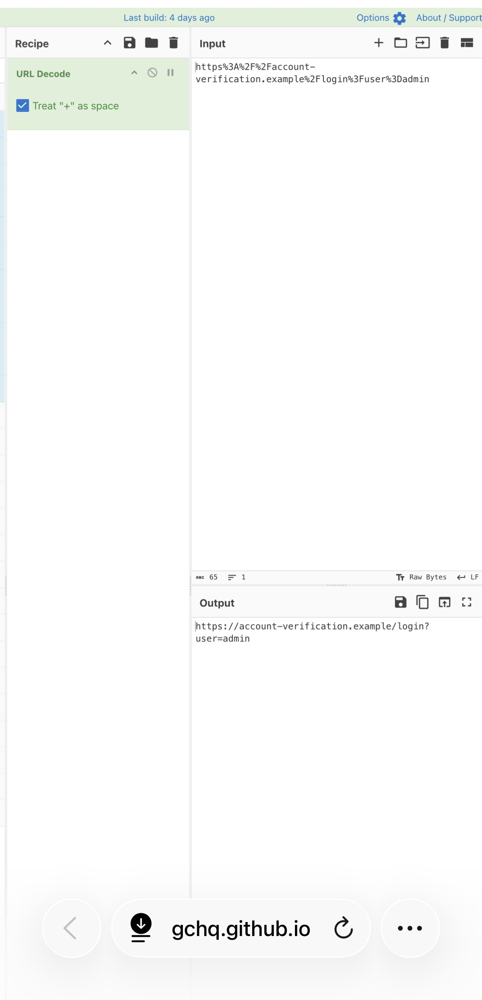
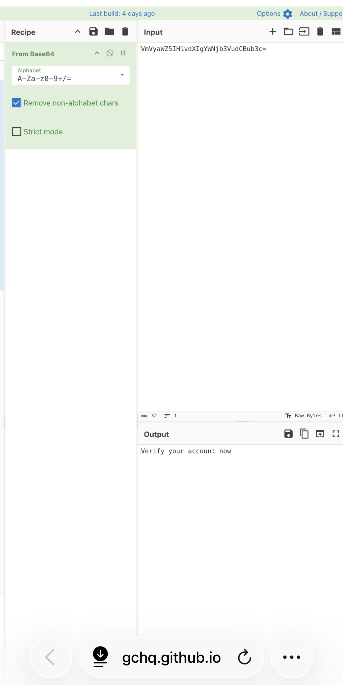

# CyberChef Suspicious URL Investigation

**SOC Analyst Cybersecurity Portfolio Project**

**Analyst:** David Jeffries  
**Tools:** CyberChef | GitHub  
**Focus:** Phishing Analysis | URL Decoding | Base64 Decoding | Threat Investigation  
**Environment:** Simulated Cybersecurity Training Lab  
**Project Status:** Completed

---

## Project Overview

This project demonstrates a hands-on simulated phishing investigation using CyberChef, a free browser-based data analysis tool.

The investigation involved decoding a URL-encoded login link and a Base64-encoded account-verification message, examining possible phishing indicators, and documenting findings.

All artifacts are fictional training examples. No real malware or malicious websites were accessed.

## Investigation Objectives

- Decode a URL-encoded link.
- Examine the decoded URL for potential phishing indicators.
- Decode a Base64-encoded message.
- Identify possible social-engineering language.
- Document findings and recommended response actions.
- Preserve screenshots as investigation evidence.

## Tools and Technologies

| Tool | Purpose |
|---|---|
| CyberChef | Analyze encoded text |
| URL Decode | Reveal URL-encoded characters |
| From Base64 | Decode Base64 messages |
| GitHub | Store project evidence and reports |
| Markdown | Document investigation findings |

---

## Investigation 1: Suspicious URL Analysis

### Scenario

A SOC Analyst receives an encoded URL for investigation. The objective is to reveal the destination and assess its characteristics.

### Encoded URL

```text
https%3A%2F%2Faccount-verification.example%2Flogin%3Fuser%3Dadmin
```

### CyberChef Operation

**URL Decode**

### Decoded Result

```text
https://account-verification.example/login?user=admin
```

### Investigation Findings

- The domain contains account-verification wording.
- The URL includes a `/login` path.
- The query parameter `user=admin` references an administrator account.
- URL encoding obscured certain characters before decoding.
- The `.example` domain is reserved for documentation.

**Assessment:** The fictional URL resembles a possible phishing login destination, but the URL alone does not establish malicious activity.

### Evidence 1: URL Decoding



*Figure 1: CyberChef URL Decode operation showing the original encoded URL and decoded output.*

---

## Investigation 2: Base64 Message Analysis

### Scenario

A SOC Analyst discovers an encoded message during a simulated phishing investigation. The objective is to decode the message and assess its wording.

### Encoded Message

```text
VmVyaWZ5IHlvdXIgYWNjb3VudCBub3c=
```

### CyberChef Operation

**From Base64**

### Decoded Result

```text
Verify your account now
```

### Investigation Findings

- The decoded message requests account verification.
- The wording creates a sense of urgency.
- Similar language can be used in credential-phishing campaigns.
- Base64 encoding is not inherently malicious.

**Assessment:** The message illustrates a possible social-engineering pretext in a fictional training scenario.

### Evidence 2: Base64 Decoding



*Figure 2: CyberChef From Base64 operation showing the encoded message and decoded output.*

---

## Security Findings Summary

| Indicator | Observation | Interpretation |
|---|---|---|
| URL encoding | Encoded URL characters | Requires decoding |
| Account verification | Verification-themed domain | Possible phishing pretext |
| Login path | `/login` | Potential credential-entry page |
| Admin parameter | `user=admin` | Administrator-related reference |
| Base64 encoding | Encoded text | Requires decoding |
| Urgent wording | Verify your account now | Possible social-engineering indicator |

**Overall Assessment:** Suspicious characteristics identified in fictional training samples.

**Confirmed Malicious Activity:** None  
**Confirmed Account Compromise:** None  
**Malware Detected:** None

## Recommended Incident Response

1. Avoid opening unverified links.
2. Verify account-related requests through trusted channels.
3. Examine the original sender and email headers.
4. Review relevant authentication logs when available.
5. Investigate suspicious account activity.
6. Escalate credible phishing indicators to the security team.
7. Document evidence and response actions.
8. Provide phishing-awareness guidance when appropriate.

## Skills Demonstrated

- CyberChef analysis
- URL decoding
- Base64 decoding
- Phishing indicator identification
- Security evidence collection
- SOC incident-triage fundamentals
- Investigation documentation
- Incident response recommendations

## Project Files

| File | Description |
|---|---|
| [README.md](README.md) | Main project documentation |
| [IMG_5263.jpeg](IMG_5263.jpeg) | URL decoding screenshot |
| [IMG_5264.jpeg](IMG_5264.jpeg) | Base64 decoding screenshot |
| [incident_report.md](incident_report.md) | Detailed investigation report |

### Full Investigation Report

**[Read the Security Investigation Report](incident_report.md)**

## Project Limitations

This project uses fictional training data. No live phishing infrastructure, real malware, compromised accounts, or production security logs were investigated.

The findings demonstrate foundational analysis techniques rather than confirmation of an actual cyberattack.

---

## About the Analyst

**David Jeffries**

Cybersecurity portfolio focused on security operations, threat detection, security monitoring, and incident investigation.

**Certification:** Google Cybersecurity Professional Certificate

**Technical Skills:** Python | Linux | Bash | KQL | Security Log Analysis | CyberChef

### Professional Links

**GitHub:** https://github.com/David31005

**Cybersecurity Portfolio:** https://github.com/David31005/cybersecurity-portfolio

**LinkedIn:** https://www.linkedin.com/in/david-jeffries001

---

*Completed as a hands-on SOC Analyst cybersecurity training project.*
